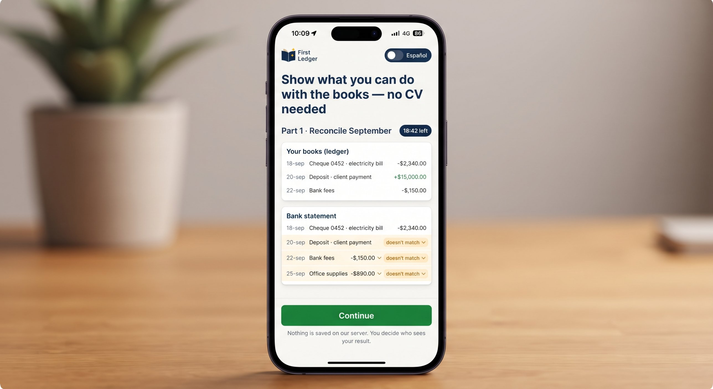
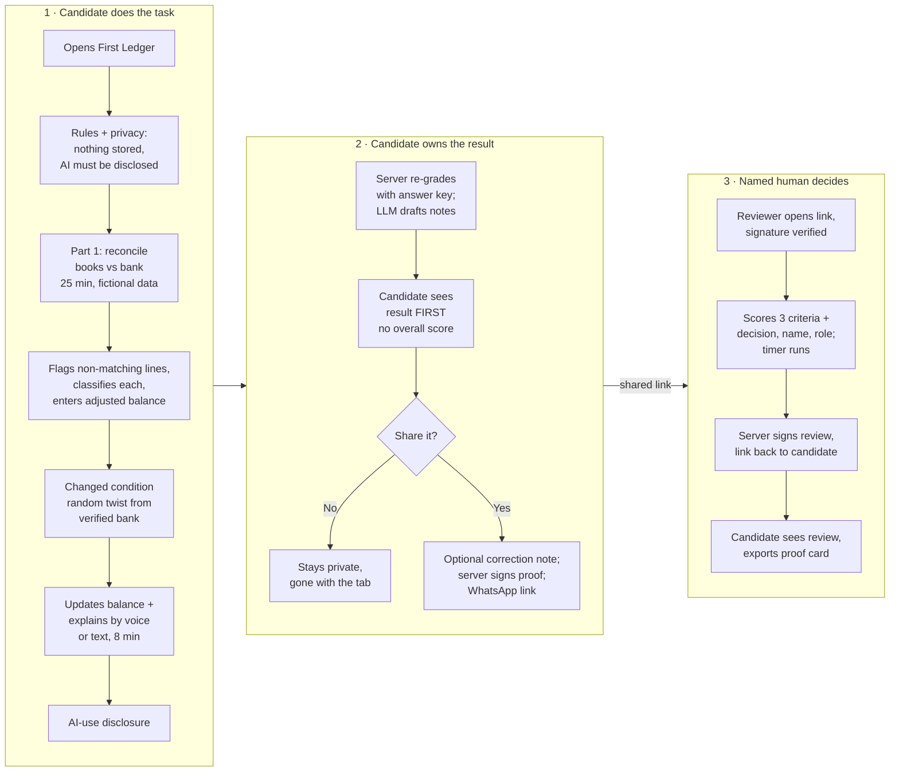
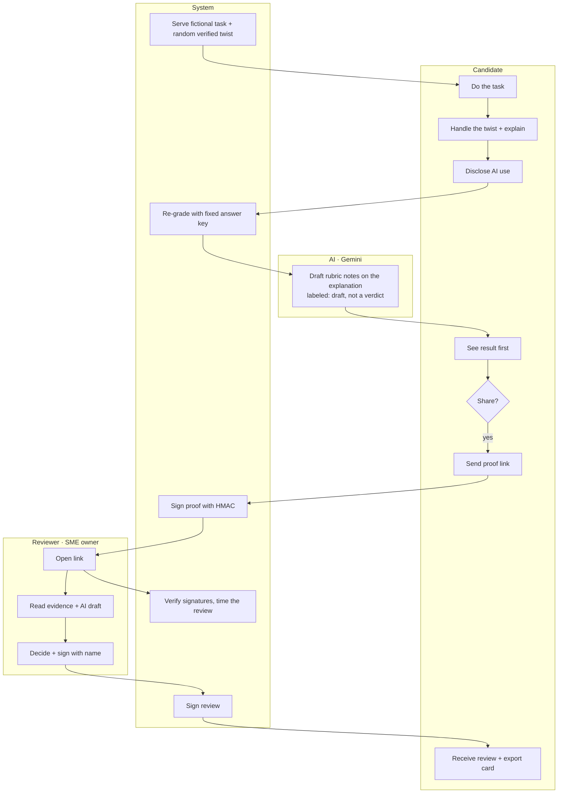

# PACKET — First Ledger (Week 9 · Business Bending)

**Builder:** Karom Asael González Martínez · Team 2 · Role this week: USER

**Primary vacuum (Blueprint):** FIRST-PROOF

**My declaration:** a Ruth-inspired bookkeeping proof task that honors candidate ownership and fair evidence.

---

## 1. The problem, in my words

Ruth is 22. She spent years keeping the books for her family's sack business, with no contract, no payslip and no paper. When she applied for accounting jobs, every company that filtered by CV saw nothing. One didn't even answer. The only employer that hired her did something different: it gave her a practical test, and she passed.

So the rung didn't fail her for lack of skill. It failed her for **lack of proof**. And the old fix, a take-home test, is breaking too. Anyone can now finish a take-home exercise with ChatGPT, so the result alone no longer proves who did the work.

First Ledger is a short, bounded bookkeeping task that produces **evidence a small-business owner can trust**:

- the work itself, checked against a fixed answer key;
- a **changed condition** in the middle of the task, so a pre-solved answer doesn't help;
- the candidate's own **spoken or written explanation** of what changed;
- an honest **AI-use disclosure**;
- a **named human reviewer** who decides, in under 10 minutes.

The candidate sees everything first, owns the record and decides who sees it. Nothing is stored on a server.

## 2. Exact user

**Primary user: the candidate.** A 19–25-year-old in Mexico with real but informal bookkeeping experience (a family business, helping a relative, school practice) and no formal job history. Uses a phone more than a laptop, knows Excel basics, and has been rejected or ignored by CV filters. Persona anchor: **Ruth** (22, accounting student, family sack business).

**Secondary user: the reviewer.** The owner or accountant of a Mexican micro or small business who needs a junior bookkeeper and has no HR department. Will spend at most 10 minutes per candidate.

## 3. Success definition

> **Before the module closes**, a candidate can open the live URL, complete the reconciliation task and the changed condition, explain the change by voice or text, see their own result first, and send a signed proof link. A reviewer can open that link, confirm it wasn't edited, complete the rubric with their name in under 10 minutes, and send a signed review back to the candidate.

Measured in the test pass: full candidate → reviewer → candidate loop works on the deployed URL; tampering with a link is detected; review timer shows the real review time.

## 4. Mockup (image-generated)

*Image generated with the free image model of my LLM, from this prompt:*

> A clean mobile web app screen for a Mexican bookkeeping skills test called "First Ledger". Top: small logo with an open ledger book icon, and a language toggle button "Español" in the top right. Title: "Show what you can do with the books — no CV needed". Below, two stacked cards labeled "Your books (ledger)" and "Bank statement" with short rows of dates, descriptions and peso amounts, some rows highlighted in soft amber as "doesn't match" with a dropdown underneath. A dark navy timer chip "18:42 left" next to the heading "Part 1 · Reconcile September". At the bottom, a green full-width button "Continue" and a small grey note "Nothing is saved on our server. You decide who sees your result." Flat design, warm off-white background, navy and green accents, readable sans-serif, realistic iPhone frame, all text in English.

## 5. The flow (Mermaid)

### Flowchart

### Swimlane — who does what

## 6. Benchmark line

- **The best existing solution on Earth for this is** Forage's employer-designed job simulations (EY, KPMG, Goldman Sachs), plus work-sample testing tools like TestGorilla.
- **Mine differs by** being built for a Mexican micro-business owner instead of a Fortune 500 recruiter: the reviewer actually sees the work (Forage employers don't), the test includes a changed condition and a spoken explanation so an AI-solved answer isn't enough, and the candidate owns the record and decides each share (in TestGorilla the employer owns the results).

## 7. The long view (3 years)

If this slice works, First Ledger becomes a library of short, observed proof tasks for the first rungs that AI is thinning: bookkeeping, customs paperwork, inventory, customer support. Each one is designed with a small-business association and reviewed by paid local professionals. The candidate carries a wallet of signed proofs instead of a CV that says "no experience", and employers or institutions (not candidates) pay for review. The walls I'm keeping on purpose: no central database of failures, no ranking of people, and a human signature on every decision.

## 8. Scope cut — what I'm NOT building

- No accounts, no login, no database (so no personal data stored, and no failure history anywhere).
- No job board, CV builder, ranking or overall "employability score" (Blueprint condition 1).
- No real client work and no payments (condition 4); the pilot uses fictional data only (condition 5).
- One task family only: September bank reconciliation for a fictional sack-and-raffia shop. Three verified twists.
- No cryptographic identity check of the candidate; the reviewer verifies who they are in person or on a call.
- No reviewer marketplace or payment flow (that's José Fernando's MONEY slice).

## 9. Architecture + stack

| Layer | Choice | Why |
|---|---|---|
| Frontend | Next.js 15 (App Router) + React 19 + TypeScript, plain CSS | Same free stack as previous weeks; mobile-first |
| **LLM** | Google Gemini (`gemini-3.8-flash`, falls back to `gemini-3.6-flash`) via server route | Drafts rubric notes on the explanation. Labeled "AI draft". If no key: rule-based fallback labeled "Simulated AI" |
| **Structured / verified data** | Fixed task bank (ledger, bank statement, answer key, 3 twists with keys) graded deterministically on the server | A reconciliation balances or it doesn't. AI never decides correctness |
| **One more: voice** | Browser Web Speech API (`es-MX` / `en-US`) for the spoken explanation, text fallback | The "live explanation" condition, in the candidate's own words |
| **One more: automation** | HMAC-SHA256 signing of proof and review links | Reviewer can verify the record wasn't edited, with no database |
| Hosting | Vercel (free) | Env vars hold `GEMINI_API_KEY` and `PROOF_SECRET` |

**Dragon Stack check:** LLM ✔ · verified data ✔ · voice ✔ (+ signing automation).

**Security floor:**
1. No secrets in the repo: keys only in Vercel env vars; `.env.example` has placeholders.
2. No personal data stored, so no auth is needed: nothing is written server-side; records live only in the links the candidate chooses to share.
3. RLS: not applicable (no database).
4. Every input validated: lengths, types, enums; the explanation is capped and sent to the LLM as data, not instructions.
5. Only invented data: fictional business, fictional amounts, and demo names labeled as demo.

## 10. Blueprint conditions → how the build honors them

| # | Condition | In First Ledger |
|---|---|---|
| 1 | No CV builder, job board, universal score, automated rejection/ranking | Results are item-level evidence. No total score, no pass/fail, and the system never rejects; only a named human decides |
| 2 | Bounded task, clear rubric, disclosed AI, live revision/explanation, named reviewer | 25 + 8 min limits, rubric shown up front, mandatory AI disclosure, spoken/written explanation of the twist, reviewer name required to sign |
| 3 | Candidate sees result first, can correct, export, authorize each share; failures private | Result screen before any share; correction note; export card; every link is created by the candidate; nothing stored |
| 4 | **Shadow clause:** no unpaid production work, no permanent failure label | Fictional task only, no client work; no stored attempts, so no failure can follow anyone |
| 5 | Fictional/public data; no reuse of private submissions | Fictional business; footer notice that reviewers may not reuse submissions; nothing kept to reuse |
| 6 | Stop rules (2 of 3 employers, ≤10 min review, useful evidence) | Review page measures review time and asks "Did this add hiring evidence beyond a CV?"; results feed the pilot stop rule |

## 11. Test plan

**Mechanical pass**
1. Unit tests: answer key balances on both sides for the base task and all 3 twists.
2. Unit tests: grader marks a perfect submission all-correct and a wrong one item by item.
3. Unit tests: signature verifies; any edited character in the payload fails.
4. Input validation: oversize explanation and wrong types return 400.
5. End-to-end in a real browser (Playwright): full candidate → reviewer → candidate loop; tampered link shows the warning.
6. Feedback route with no API key returns the simulated output, labeled.

**Persona test (Layer 1)**
Synthetic user built from my User research: *"Ruth, 22, accounting student, did her family's sack-business books for years, uses her phone for everything, gets nervous with timers, reads instructions fast and skips long text, gives up quietly when she feels judged."* Walk her through screenshots of every screen, log every hesitation, fix the worst one, redeploy.
