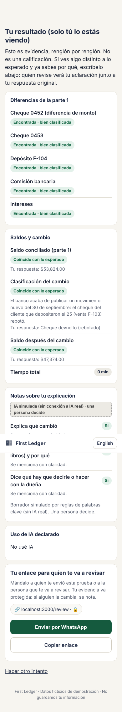

# PERSONA TEST — First Ledger (Week 9)

## Who the synthetic user was

Built from my User research (Ruth's interview), run in a fresh chat that had never seen the product:

> **Ruth, 22**, accounting student in the State of Mexico. For years she kept the books for her family's sack business, with no contract and nothing on paper. She was ignored or rejected by companies that only looked at her CV and felt *"que no servía para esto de la contabilidad."* Uses her phone for everything, knows Excel basics, knows reconciliation in practice but maybe not every textbook term. Gets nervous with timers, reads fast and skips long text, **gives up quietly when she feels judged or confused.**

**Method:** phone screenshots (390 px) of every screen, in order: intro → part 1 empty → part 1 filled → twist empty → twist filled → AI disclosure → private result → share → signed review. The persona narrated each screen out loud in first person; then, out of character, logged each confusion.

## Where she got lost

| # | Screen | Confusion (Ruth's words) | Severity | Would quit? |
|---|---|---|---|---|
| 1 | Intro | "Cambio de app y ¿se me borra todo?" · "No guardamos nada… ¿cómo lo va a ver quien revisa?" | Med | No |
| 2 | Part 1 | "¿En cuál lista? ¿En las dos?… ¿cuenta doble?" Two long lists stacked; big dark timer. | **High** | No (stalls) |
| 3 | Part 1 filled | Dropdown options cut off. "¿Sí está contando el reloj?" | Med | No |
| 4 | Twist | "Dice 'nuevo' saldo… ¿tiene que ser diferente? ¿Es trampa?" · "¿El botón Hablar graba mi voz? ¿Quién la oye?" | **High** | No (may answer wrong) |
| 5 | Twist filled | "No sé si eso es suficiente explicación." | Low | No |
| 6 | AI disclosure | "Sé honesto… suena a que ya sospechan de mí." · "¿La calculadora cuenta?" | Low–Med | No |
| 7 | Private result | "¿No que no era calificación? Esto se ve como calificación." · "¿Me revisó una máquina?" · "¿Con quién lo comparto?" | **High** | Maybe |
| 8 | Share | "¿¿Qué es esto?? Un choro de letras… parece virus o de esos mensajes de fraude." · "'Cualquier cambio se detecta' suena a que me están vigilando." | **High** | **Yes** |
| 9 | Signed review | "¿Qué sigue? ¿Quién me contacta?" · "'¿Esto te dio información útil que un CV no te da?' ¿Me lo preguntan a mí?" | High (trust) | No |

## The worst one

**Screen 8, the share step.** After doing all the work, Ruth was handed a huge, raw, encoded link, no clear recipient, and a sentence that sounded like an accusation. "Mantener privado" sat right next to it as the safe-looking exit. She wouldn't close anything; she'd just never send it. No reviewer would ever see her, and the product would repeat exactly the silence it claims to fix.

## What I fixed (commit `fix: persona test`)

| Problem | Fix |
|---|---|
| **Raw link looked like a scam (worst)** | The encoded link is no longer shown. The candidate sees a short chip (`first-ledger…/review · 🔒`), a primary **"Enviar por WhatsApp"** button with a friendly pre-filled message, and "Copiar enlace" as a fallback. Same for the reviewer's reply. |
| No clear recipient | "Mándalo a quien te envió esta prueba o a la persona que te va a revisar." |
| Tamper note sounded like an accusation | "Tu evidencia va protegida: si alguien la cambia, se nota." |
| Which list to flag | "Si una diferencia aparece en las dos listas, márcala en una sola (cualquiera de las dos cuenta)." The grader already accepted either side. |
| "Nuevo saldo" implied it must change | "Saldo conciliado después del cambio (puede quedar igual)." |
| Unsure how long to explain | "Con 2 o 3 frases basta." |
| Does the voice get recorded? | "Solo se convierte en texto aquí; el audio no se guarda." |
| Disclosure felt like suspicion; calculator? | "Cuéntanos qué herramientas usaste. Usar IA no te quita nada… La calculadora o Excel no cuentan como IA." |
| "Correcto" looked like a grade | Pills now say "Coincide con lo esperado". |
| Reviewer-only question shown to the candidate | Removed from the candidate's final view. |

## Not fixed (logged for next iteration)

- **Save progress if she switches apps** (#1). Would need local storage of the attempt; deferred because a saved attempt on a shared phone conflicts with "unsuccessful attempts remain private".
- **Side-by-side matching on a phone** (#2). Needs a different mobile layout; larger change than the deadline allows.
- **"0 min" timings** in the screenshots: an artifact of the automated run (completed in seconds). Real attempts show real minutes.
- **"What happens next"** after a reviewer chooses "paid trial" (#9): depends on Rodrigo's OPERATOR workflow and José Fernando's MONEY model. The review note field is where the reviewer says how to continue.

## After the fix — the share step

